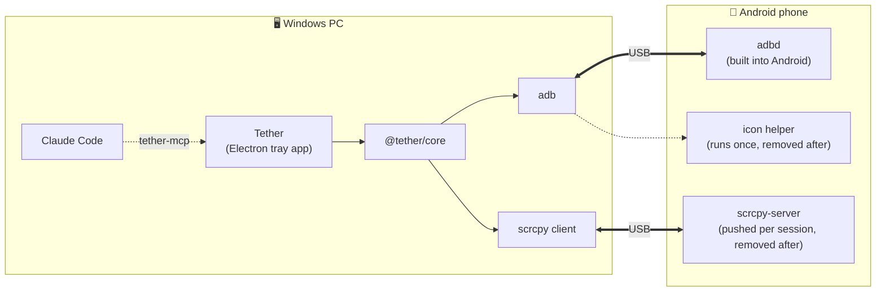

<div align="center">


# Tether

**Your Android phone, inside your Windows PC.**

Mirror it, control it, share files and clipboard both ways,<br>
open any phone app in its own window, and let Claude Code help, under your rules.

[](https://github.com/shaunmarv3/Tether/releases/latest)


[](LICENSE)

[Features](#features) · [Install](#install) · [Phone setup](#phone-setup-one-time) · [AI Pilot](#ai-pilot-claude-code) · [How it works](#how-it-works) · [Build](#build-from-source)

</div>

---

## Features

| | |
|---|---|
| 📱 **The phone, at full height** | Mirror and control your phone with mouse and keyboard, with phone sound (Android 11+). Turn it to landscape, or pop it out into its own window. |
| 🪟 **App windows** | Open any phone app in its own PC window, then save how they're arranged as a **Layout** you can bring back in one click. |
| 📁 **Files** | Browse the phone's folders. Drag files onto Tether to send them; drop an `.apk` to install it (Tether asks first). |
| 📋 **Clipboard** | Copy on one side, paste on the other. One-time codes stay hidden. Phone screenshots can land straight in the PC clipboard. |
| 🔔 **Notifications** | Read what's on the phone from the PC, with the full message one click away. |
| 🎬 **Screenshots & recording** | Save a screenshot or record the phone screen (with sound) to your PC. |
| 🤖 **AI Pilot** | Let [Claude Code](https://claude.com/claude-code) use your phone for a task. You approve the plan, and Tether guards every step. |
| 🔒 **Security** | Password, auto-lock, trusted phones only, one-click **Lockdown**, and a checkup that shows what needs a look. |

**Nothing gets installed on the phone.** Tether lives in the system tray: closing the window keeps it running; quit it from the tray icon.

---

## Install

1. Download **`Tether-Setup-<version>.exe`** from the [latest release](https://github.com/shaunmarv3/Tether/releases/latest),
   or build it yourself (see [Build from source](#build-from-source)).
2. Run it and click **Next**. It installs for your Windows user only, so there's no admin prompt.

   > ⚠️ The installer isn't code-signed yet, so Windows SmartScreen warns the first time:
   > click **More info → Run anyway**.
3. Tether walks you through first run:
   1. **Set a password** (8+ characters). You type it each time Tether opens; you can turn that off on the Security page.
   2. **Download the engine:** scrcpy + adb from scrcpy's official GitHub release (~11 MB, once). Its SHA-256 is
      checked before anything runs.
   3. **Connect your phone** over USB (see [Phone setup](#phone-setup-one-time)), then click **Trust this phone**.

**Uninstall:** Settings → Apps → Installed apps → **Tether** → Uninstall. Your data in `%LOCALAPPDATA%\Tether`
(password, trusted phones, layouts, the engine) is kept; delete that folder to remove it too.

### Requirements

- **PC:** Windows 10 or 11, 64-bit
- **Phone:** Android 5.0+ (Android 11+ for phone sound), with USB debugging on

---

## Phone setup (one time)

1. **Settings → About phone → tap "Build number" 7 times** to unlock Developer options.
2. **Developer options → USB debugging: ON.**
3. Plug the phone in, tick **"Always allow from this computer"** and accept **"Allow USB debugging?"**
4. *Optional:* Android 11+ forgets a PC after 7 days without a connection. To keep this PC trusted, turn on
   **Developer options → "Disable adb authorization timeout"**, or let Tether do it for you (the toast on Home,
   or Security → Phone trust). The catch: a stolen PC then stays trusted until you tap
   "Revoke USB debugging authorisations" on the phone.
5. *Xiaomi / Redmi / POCO:* also turn on **"USB debugging (Security settings)"**, then reboot.

---

## AI Pilot (Claude Code)

Tether can let [Claude Code](https://claude.com/claude-code) use your phone. Open **AI Pilot**, click
**Connect Claude Code**, then ask Claude Code for a phone task, for example *"reply to Mom on WhatsApp: on my way"*.

The rules live in Tether, not in the AI:

- Nothing happens until you **Allow** a plan, and only the apps in it can be used.
- Sends and reactions show who and what first, and you can edit the message. A wrong chat stops the task.
  A switch lets sends to the planned chat skip the popup.
- Deletes, installs, settings and system panels ask you. Lock screens wait for you to unlock them.
  Money apps and payment buttons are always blocked.
- **Stop** any time with **Ctrl+Alt+X** or Stop in the title bar. Locking Tether or unplugging the phone stops it too.

> [!IMPORTANT]
> Text Claude reads from the phone goes to Anthropic, like the rest of your Claude Code chat.

---

## How it works

Tether is a single app on the PC. It builds on [scrcpy](https://github.com/Genymobile/scrcpy) and Android's own
`adb`, and shows the phone screen inside its own windows.



App icons come from a tiny helper (`apps/desktop/helper/IconDump.java`) that runs once with `app_process`, the way
scrcpy runs its server, and is removed right after. The icons are kept on the PC.

### Security

- Every PC has to be approved on the phone before it can connect.
- Tether only shows or controls phones you trusted in Tether.
- USB only. Nothing listens on the internet.
- The app is protected by a password (8+ characters) and locks when Windows locks or the PC sits idle.
  You can turn the password off; Windows lock and idle still close the phone windows and stop the AI.
- A one-click **Lockdown** button disconnects everything.

---

## Build from source

Requires **Node.js 22+**.

```bash
npm ci          # install exactly what package-lock.json lists
npm run dev     # run Tether from source
npm test        # core tests
npm run dist    # installer → apps/desktop/release/Tether-Setup-<version>.exe
```

The icon helper ships prebuilt (`apps/desktop/resources/tether-icons.jar`). To rebuild it you need a JDK and the
Android SDK (platform 35 + build-tools 35.0.0): `node apps/desktop/scripts/build-helper.mjs`.

### Project layout

```
apps/desktop     Electron tray app (UI)
packages/core    device manager · adb wrapper · scrcpy client · AI pilot guard
packages/mcp     tether-mcp: the phone tools Claude Code sees (talks only to the running Tether)
```

---

## Credits & license

Built on [scrcpy](https://github.com/Genymobile/scrcpy) by Genymobile (Apache 2.0) and Android platform-tools.

Tether is released under the [MIT license](LICENSE).
